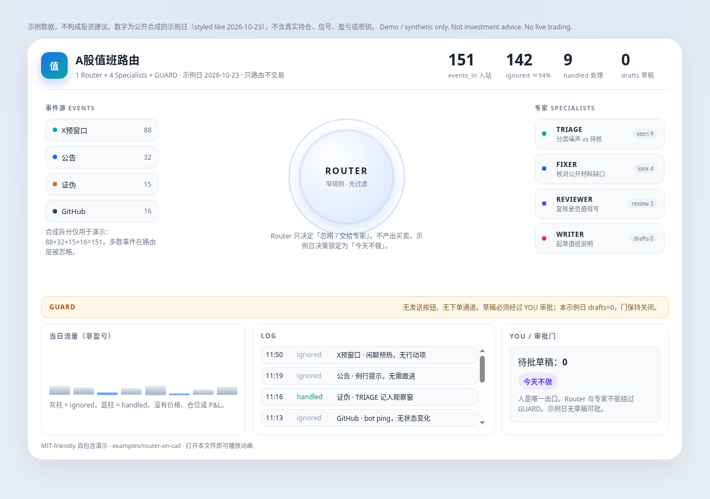
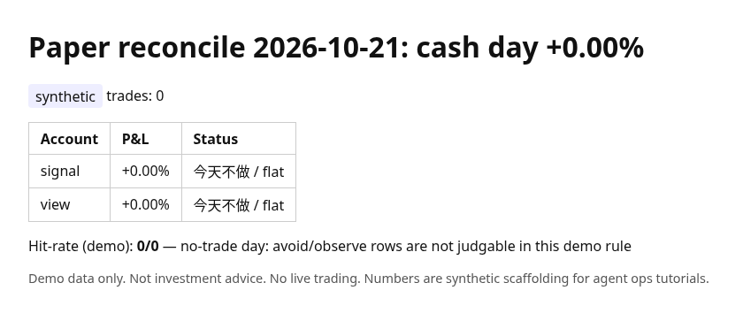

# agent-market-ops

[](https://github.com/anan421/agent-market-ops/actions/workflows/ci.yml)
[](LICENSE)
[](pyproject.toml)

**Agent-native market ops** — scrape → validate → brief-lint → reconcile — schema-first, Codex/Claude-ready, offline demos only.

> **Demo data only. Not investment advice. No live trading.**  
> Synthetic prices, fake ledgers, and example briefs so you can practice the *ops* layer without leaking edge or credentials.

<p align="center">
  
</p>

## Who / problem / what

| | |
|---|---|
| **Who** | Maintainers who run a daily market-ops loop with coding agents (OpenAI Codex, Claude Code, …). |
| **Problem** | Agents glue well but miss silent schema drift, fee math mistakes, and “cash day still has picks” regressions. |
| **What** | JSON schemas + brief lint + fee scaffolding + offline reconcile HTML + an Agent Skill (`SKILL.md`) for that loop. |

Also includes **Hypothesis** property tests under `formal/` (cash-day fees, reflexivity windows, and related invariants) so CI can catch regressions that unit fixtures miss.

中文摘要：面向「每天用 Agent 跑采集 → 校验 → 简报检查 → 对账页」的维护者。Schema 优先、费用可审计、简报有锁定句式检查。仓库只有演示数据，不是交易系统。

## 30-second quickstart

```bash
git clone https://github.com/anan421/agent-market-ops.git
cd agent-market-ops
python3 -m venv .venv && source .venv/bin/activate
pip install -e ".[dev]"
pytest -q
```

```bash
python -m pipeline.fetch_prices_demo --symbol DEMO01 --days 5
python -m pipeline.brief_check_demo examples/brief.md
python -m pipeline.reconcile_demo --date 2026-10-21 -o /tmp/reconcile.html
```

Point your agent at [`SKILL.md`](SKILL.md) (Agent Skills format) for the daily loop.

<p align="center">
  
</p>

<details>
<summary><strong>Router-on-call demo</strong> — open the synthetic A-share duty dashboard</summary>

Self-contained HTML (no build, no CDN, no keys): [`examples/router-on-call/`](examples/router-on-call/).

```bash
python3 -m http.server 8765
# open http://127.0.0.1:8765/examples/router-on-call/
```

Or open `examples/router-on-call/index.html` directly. Sample day (**2026-10-23**): 151 events in → ~94% ignored → drafts **0** → decision **今天不做**. Routing only — no positions, signals, or P&amp;L.

</details>

---

## Layout

```
agent-market-ops/
├── SKILL.md                 # Agent Skills entry for the daily loop
├── schema/                  # JSON Schema (draft 2020-12)
├── pipeline/                # demo Python modules (no network)
├── formal/                  # Hypothesis property checks
├── examples/                # sample brief, ledger.csv, reconcile HTML
│   └── router-on-call/      # A-share on-call router dashboard (synthetic)
├── docs/assets/             # README preview screenshots
├── tests/                   # pytest
├── CONTRIBUTING.md          # Codex-oriented PR workflow
└── SECURITY.md
```

---

## Brief lint (demo rule)

On days whose ```action``` block contains **今天不做**, the brief must not carry a non-empty ```picks``` fence. Unclosed markdown fences always fail.

```bash
python -m pipeline.brief_check_demo examples/brief.md
# → OK
```

---

## Fees (documentation example)

`pipeline/fees.py` exposes an illustrative schedule (commission floor, sell-side stamp duty, transfer fee, slippage). Replace with your broker’s real schedule before any serious paper study. Round-trip cost for large notionals is on the order of **~0.30%** in the default table — a teaching constant, not a quote.

---

## Using with OpenAI Codex / Claude Code

See [CONTRIBUTING.md](CONTRIBUTING.md). Typical agent tasks that fit this repo:

1. Add a schema field + example row + pytest in one PR.
2. Extend `brief_check_demo` with a new locked phrase and failing fixtures first.
3. Regenerate `examples/reconcile_sample.html` from `reconcile_demo`.

Install the skill by pointing your agent at `SKILL.md` in this repo.

---

## Markets (`markets/`)

One JSON config per market (`cn_a`, `hk`, `us`, `crypto`, `futures`, `fx`, `demo`), loaded with `markets.load(name)`. CI generates its per-market matrix from `markets.available()`.

> **Example values:** `fee_bps` and `price_limit_pct` (and every config carries `example_values: true`) are illustrative round numbers, not real exchange or broker parameters. Non-cash-flow asset classes (`crypto`, `commodity`, `fx`) must set `has_cashflow: false`.

---

## Disclaimer / 免责声明

> 巴菲特、索罗斯、马斯克、梁文峰均为 AI 角色名，与真人无关，未经其本人参与或背书，也不代表其本人观点。
>
> "巴菲特", "索罗斯", "马斯克" and "梁文峰" are names of AI personas only. They are not affiliated with, endorsed by, or representative of the views of any real person.

- English: Educational scaffolding only. No offers to buy or sell securities. Authors are not responsible for trading losses.
- 简体中文：仅供学习与 Agent 运维脚手架演示。不构成任何证券投资建议，作者不对交易损失负责。

## License

MIT © 2026 anan421 / Vincent Gu — see [LICENSE](LICENSE).
